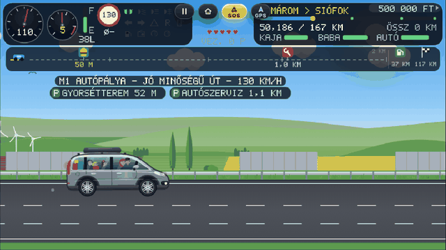
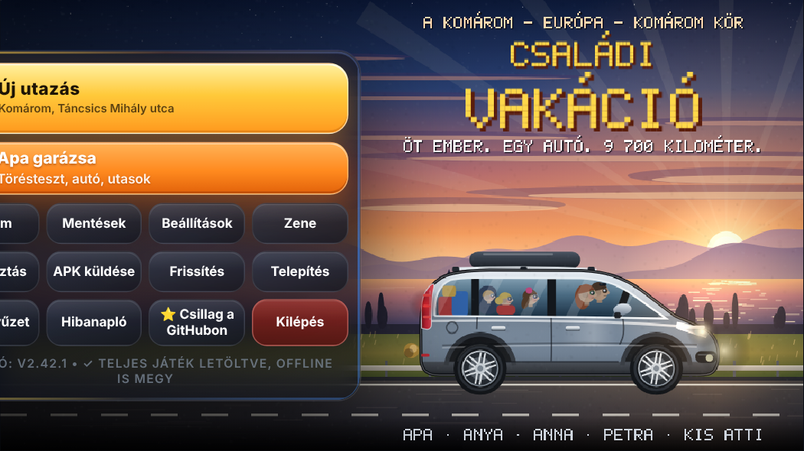
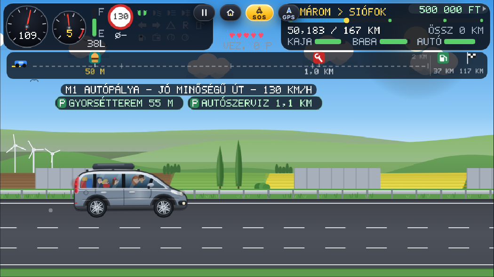

🇬🇧 English · [🇭🇺 Magyar](README.hu.md)

# 🚐 Family Vacation (Családi Vakáció)

A side-scrolling family road-trip game: drive a minivan with five family members from Komárom across Europe, with real distances, real fuel use and a real budget (in forints).



### [▶ Play now](https://strattila90-hue.github.io/Ede-kaland-/) · [📱 Download APK](https://github.com/strattila90-hue/Ede-kaland-/releases/download/apk/csaladi-vakacio.apk)

[](LICENSE) [](https://github.com/strattila90-hue/Ede-kaland-/commits) [](https://github.com/strattila90-hue/Ede-kaland-)   

The game is in Hungarian. It runs in the browser, can be installed as a PWA, and works offline once loaded.

## Features

- **22 legs, about 9,700 km, 14 countries**: Komárom, Lake Balaton, Zagreb, the Vršič pass, Venice, Rome, Nice, Madrid, Lisbon, Paris, Berlin, Prague, Vienna and back home.
- **Real-scale driving**: distances, speed limits per country, fuel consumption and a 60 L tank of a 125 hp, 7-seat minivan. Terrain with climbs, descents and a hairpin serpentine (50 bends) on the Vršič pass.
- **The family**: Dad, Mum, Anna, Petra and baby Atti. Choose who travels; mood, tiredness and needs affect the trip. Characters speak with text-to-speech.
- **Stops along the way**: petrol stations, shops, a burger place, a car wash, a service garage, mini-games.
- **Interactive GPS map** with the whole route, and a trip ledger, photo album and achievements.
- **Damage, total loss, tow truck and repair shop**, plus "Dad's garage": a **crash-test lab** (walls, dummies, braking tests, replay, X-ray of the drivetrain) and a **wrecking workshop** with 11 tools (hammer, bullets, laser, press, explosives, heat and frost chamber).
- **Every town looks different** (v2.43): buildings in each country's own style, and every city has its own landmarks (Eiffel Tower, Colosseum, Brandenburg Gate, Atomium, Sagrada Família, Komárom's Monostor fortress...); every village has its own church and a unique sight.
- **Lifelike roads** (v2.43): roadside police with a tripod speed camera announced 600 m ahead, accident scenes with a burning wreck, firefighters putting it out, paramedics with injured people, debris and a traffic jam; buses and trucks with brake lights, turn signals and diesel smoke; help stranded drivers with a handshake button. Game kilometres pass twice as fast as before.
- **Car radio**, synthesized engine sound, day and night, weather, wildlife, traffic.
- **Android app (APK)** with background updates, plus keyboard, touch and gamepad-style controls for any screen size.

## Screenshots




## Run locally

No build step and no dependencies: plain HTML and classic `<script>` files.

```bash
git clone https://github.com/strattila90-hue/Ede-kaland-.git
cd Ede-kaland-
python3 -m http.server 8765
# open http://localhost:8765/index.html
```

The service worker (offline mode) only works over `http://`, not `file://`.

## Tech

Vanilla JavaScript, HTML5 canvas (all graphics drawn in code), Web Audio for sound, a PWA with a service worker, and a thin WebView-based Android wrapper built by GitHub Actions. Tests use Playwright.

## Contributing

Issues and pull requests are welcome. See [CONTRIBUTING.md](CONTRIBUTING.md).

## License

[MIT](LICENSE) © 2026 strattila90-hue

---

⭐ If you like it, please give it a star — it really helps!
